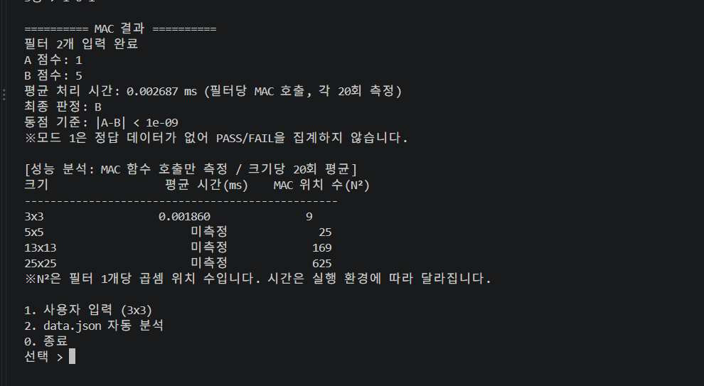

# Codyssey E1-3: Mini NPU Simulator

## 프로젝트 소개

이번 미션에서는 Python의 2차원 리스트와 이중 반복문을 이용해 MAC(Multiply-Accumulate) 계산을 구현했습니다. 십자가(Cross)와 X 모양을 숫자 배열로 표현하고, 입력 패턴과 각 필터의 같은 위치에 있는 숫자끼리 곱한 뒤 모두 더해 점수를 비교합니다. 실제 NPU 칩이나 인공지능 모델을 만드는 것이 아니라 AI 계산에 쓰이는 기초 원리를 이해하기 위한 콘솔 프로그램입니다.

## 개발 환경과 파일 구조

- 개발 환경: Windows, VS Code, PowerShell, Python 3.8 이상
- 사용 라이브러리: Python 표준 라이브러리만 사용(NumPy 등 외부 라이브러리 미사용)

```text
codyssey -e1-3/
├── main.py                  # 프로그램 실행 및 MAC 계산
├── data.json                # 과제 원본 데이터(수정하지 않음)
├── README.md                # 실행 방법과 결과 리포트
├── test_json_validation.py  # JSON 오류 처리 시험
├── .gitignore               # Python 캐시 파일 제외
└── screenshots/             # 직접 실행하여 저장한 증빙 화면
    ├── mode1_result.png
    ├── mode1_input_error.png
    ├── mode2_analysis.png
    ├── mode2_analysis1.png
    └── mode2_summary.png
```

## 실행 방법

VS Code에서 프로젝트 폴더를 열고 PowerShell 터미널에 다음 명령어를 입력합니다. `main.py`와 `data.json`은 같은 폴더에 두었습니다.

```powershell
python -m py_compile main.py
python main.py
```

- `1`: 3×3 필터 A, 필터 B, 입력 패턴을 직접 입력
- `2`: 원본 `data.json`을 읽어 패턴 자동 분석
- `0`: 프로그램 종료

별도의 JSON 오류 처리 시험은 다음 명령으로 실행합니다.

```powershell
python test_json_validation.py
```

## 구현 방법과 판정 기준

MAC은 입력 패턴과 필터의 같은 위치에 있는 숫자를 곱하고, 곱한 결과를 모두 더하는 방식입니다. 외부 계산 라이브러리 없이 이중 `for` 반복문으로 구현했습니다. N×N 크기의 배열을 처리할 수 있습니다.

두 점수 차이가 `EPSILON = 1e-9`보다 작으면 부동소수점의 아주 작은 차이를 고려해 `UNDECIDED`로 판정합니다. 점수가 충분히 다르면 더 높은 필터를 선택합니다.

모드 1은 정답 데이터가 없으므로 A/B/UNDECIDED 중 하나만 판정하며 PASS/FAIL은 계산하지 않습니다. 모드 2는 `data.json`의 `expected` 값과 계산 결과를 비교해 PASS 또는 FAIL로 기록합니다.

모드 2에서는 `patterns`의 `size_N_번호` 키에서 N을 추출해 `filters[size_N]`에 있는 필터를 선택합니다. `cross` 또는 `+`는 `Cross`, `x`는 `X`로 라벨을 표준화합니다. 배열 크기나 숫자 형식, 필요한 필터 등에 문제가 있는 경우 해당 사례의 실패 이유를 출력하고 다른 사례 분석을 이어갑니다.

## 모드 1: 3×3 직접 입력과 실행 결과

필터 A(십자가):

```text
0 1 0
1 1 1
0 1 0
```

필터 B(X):

```text
1 0 1
0 1 0
1 0 1
```

입력 패턴(X):

```text
1 0 1
0 1 0
1 0 1
```

Windows PC에서 위 입력을 실제로 실행한 결과입니다.

| 항목 | 측정 및 판정 결과 |
|---|---|
| 필터 입력 | A, B 모두 입력 완료 |
| A 점수 | 1 |
| B 점수 | 5 |
| 최종 판정 | B |
| 필터당 MAC 호출 평균 | 0.003010 ms (각 20회 측정) |
| 별도의 3×3 성능표 평균 | 0.003015 ms (20회 측정) |

계산 결과를 출력하는 구역에서 필터 입력 완료 여부, 두 점수, 평균 처리 시간, 최종 판정을 함께 확인했습니다. 두 시간 값은 같은 실행에서 서로 다른 측정 구간의 결과이므로 약간 다를 수 있습니다.

## 모드 2: 원본 JSON 자동 분석 결과

원본 `data.json`의 필터 그룹 3개(`size_5`, `size_13`, `size_25`)와 패턴 6개를 분석했습니다. 콘솔에 각 패턴 키에서 크기를 추출하고 어떤 필터를 선택했는지 기록되었습니다.

| 패턴 키 | Cross 점수 | X 점수 | 판정 | expected | 결과 |
|---|---:|---:|---|---|---|
| `size_5_1` | 0.9 | 0.9 | UNDECIDED | X | FAIL |
| `size_5_2` | 8.9 | 0.1 | Cross | Cross | PASS |
| `size_13_1` | 0.3 | 14.7 | X | X | PASS |
| `size_13_2` | 7.5 | 7.5 | UNDECIDED | Cross | FAIL |
| `size_25_1` | 4.9 | 4.9 | UNDECIDED | X | FAIL |
| `size_25_2` | 52.9 | 0.1 | Cross | Cross | PASS |

**전체 테스트 6개 / PASS 3개 / FAIL 3개**입니다. 실패한 사례는 `size_5_1`, `size_13_2`, `size_25_1`입니다. 원본 정답이나 필터값을 PASS 수를 늘리기 위해 수정하지 않았습니다.

## 오류 입력 및 JSON 검증

모드 1에서 숫자가 두 개뿐인 `0 1` 또는 공백 없이 입력한 `0a1`, 문자 포함 입력 `0 A 1`을 시험했습니다. 오류 안내가 출력되고 다시 `1행 >`을 표시했습니다. `0 NaN 1`도 직접 시험하여 NaN 값을 거부하고 재입력을 요청하는 것을 확인했습니다. **무한대(`inf`) 입력은 별도로 실행해 확인하지 않았습니다.**

별도의 `test_json_validation.py`에서는 원본 `data.json`을 변경하지 않고 복사한 데이터의 `size_5_1` 첫 행을 5개에서 4개 숫자로 바꾸어 시험했습니다. 사용자 PC에서 다음 4가지 결과를 확인했습니다.

```text
[시험 결과]
잘못된 열 수를 FAIL로 처리: PASS
다음 사례 분석 계속 진행: PASS
전체 6개 사례 집계 유지: PASS
원본 파일 미수정: PASS
```

## 결과 리포트: 실패 원인과 시간 복잡도 분석

1. 이번 결과는 과제에서 제공한 원본 `data.json`을 수정하지 않고 실행한 내용입니다.
2. 전체 6개 사례 중 3개는 기대 정답과 일치했고, 나머지 3개는 FAIL이었습니다.
3. FAIL이 발생한 `size_5_1`의 두 점수는 모두 0.9였고 기대 정답은 X였습니다.
4. `size_13_2`의 두 점수는 모두 7.5였고 기대 정답은 Cross였습니다.
5. `size_25_1`의 두 점수는 모두 4.9였고 기대 정답은 X였습니다.
6. 세 사례는 점수 차이가 `EPSILON`보다 작아 `UNDECIDED`가 되었으므로 기대 정답과 일치하지 않았습니다.
7. 따라서 위 세 건의 FAIL은 스키마 손상 때문이 아니라 **동점 판정 정책에 따른 결과**로 분석했습니다.
8. 데이터의 `+`와 `x`, 필터의 `cross`와 `x`는 각각 Cross와 X로 정규화해서 비교했습니다.
9. 라벨을 정규화하지 않으면 같은 뜻의 표기가 달라 PASS/FAIL 비교가 틀어질 수 있습니다.
10. 배열의 행이나 열 개수가 맞지 않는 사례는 데이터/스키마 오류로 따로 구분해야 합니다.
11. 실제 오류 시험에서는 첫 행의 열 수를 줄여 해당 사례만 FAIL 처리되고 나머지 사례가 계속 분석됨을 확인했습니다.
12. 점수가 잘못 계산되는 경우에는 반복문과 인덱스, 누적합 계산을 확인하는 등 로직 문제를 따로 살펴봐야 합니다.
13. 부동소수점 값이 아주 미세하게 다를 때는 정확히 같은지 비교하는 대신 허용오차 정책이 필요합니다.
14. N×N 필터 하나에 대한 MAC 계산은 N²개 위치를 방문하므로 시간 복잡도는 **O(N²)**입니다.
15. 3×3은 9개, 5×5는 25개, 13×13은 169개, 25×25는 625개 위치를 계산합니다.
16. 크기가 커지면 계산할 위치가 늘어나지만 실제 시간의 증가 비율은 CPU 상태와 실행 환경 등의 영향도 받습니다.
17. 성능 측정은 크기별 MAC 함수 호출을 20회 반복하고 평균을 냈으며 파일 읽기, 입력 대기, 화면 출력은 제외했습니다.
18. 이번 실습은 Python의 CPU 기반 실행을 측정한 것이고 NPU 하드웨어를 직접 실행하거나 비교 측정한 것은 아닙니다.
19. NPU는 MAC 연산을 병렬로 처리하도록 설계되지만 메모리 대역폭과 데이터 이동 등도 성능에 영향을 줍니다.
20. 오류를 해석할 때는 데이터/스키마 문제, 계산 로직 문제, 수치 비교 정책 문제를 구분하는 것이 중요하다는 것을 확인했습니다.

### 크기별 MAC 성능 측정

다음은 Windows PC에서 **모드 2를 한 번 실행했을 때** 나온 실제 결과입니다.

| 크기(N×N) | 연산 위치 수(N²) | 평균 시간(ms, 20회) |
|---|---:|---:|
| 3×3 | 9 | 0.001395 |
| 5×5 | 25 | 0.003620 |
| 13×13 | 169 | 0.013980 |
| 25×25 | 625 | 0.034205 |

모드 1을 나중에 다시 실행했을 때 별도의 3×3 평균 시간은 0.003015 ms였습니다. 측정 시점과 구간이 달라 발생하는 차이이며 위 표의 값을 임의로 바꾸지는 않았습니다.

### 추가 학습: 1000×1000 입력과 CPU/NPU

1000×1000 크기는 한 필터에 대해 1,000,000개 위치의 곱셈과 누적 계산을 수행해야 하므로 O(N²)입니다. 크기 1000은 짝수이므로 십자가의 중심을 정의한다면 예를 들어 중앙 두 행과 중앙 두 열을 사용하는 규칙을 먼저 정해야 합니다. 전체 행렬을 보관하는 방식은 행 단위로 처리하는 방식보다 메모리를 더 사용하게 될 수 있습니다. Python 리스트의 메모리와 프로세스 전체 메모리(RSS)도 구분해야 합니다. **1000×1000 실제 실행 시간과 메모리는 측정하지 않았으며, 이 부분은 이론 분석입니다.**

## 실행 증빙 스크린샷

아래 이미지는 Windows PC의 VS Code에서 직접 실행한 화면을 저장한 것입니다.

### 모드 1: MAC 계산 및 판정



### 모드 1: 잘못된 입력 처리


### 모드 2: JSON 자동 분석 (첫 번째)


### 모드 2: JSON 자동 분석 (두 번째)


### 모드 2: 성능 측정 및 전체 결과 요약


## 배운 점

3×3 숫자 배열을 직접 입력해 필터별 MAC 점수를 비교해 보니, X 모양의 패턴이 들어왔을 때 A=1, B=5로 B가 선택되는 과정을 확인할 수 있었습니다. 입력한 숫자 개수가 맞지 않거나 문자가 들어갔을 때 프로그램이 종료되지 않고 다시 입력하도록 안내하는 것도 직접 시험했습니다. JSON 분석에서는 기대 정답이 있더라도 점수에 따라 동점으로 판정될 수 있다는 점을 알게 되었습니다. 또한 계산 시간은 실행할 때마다 조금씩 달라지기 때문에 실제로 측정한 값과 이론적인 설명을 구분해 기록하는 것이 중요하다고 생각했습니다.

## GitHub 업로드 방법

본인의 GitHub 저장소에 올릴 때 다음 명령을 사용합니다.

```powershell
git status
git add .gitignore README.md main.py data.json test_json_validation.py screenshots/
git commit -m "Update E1-3 documentation and evidence"
git push
```

이미 커밋한 파일은 변경된 내용이 없으면 다시 커밋되지 않습니다. 업로드한 뒤 GitHub에서 README의 이미지 5장이 제대로 표시되는지 확인했습니다.

