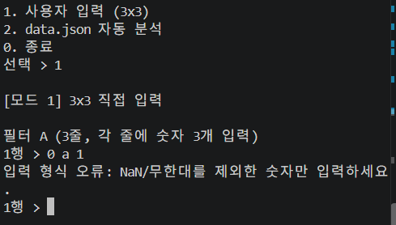
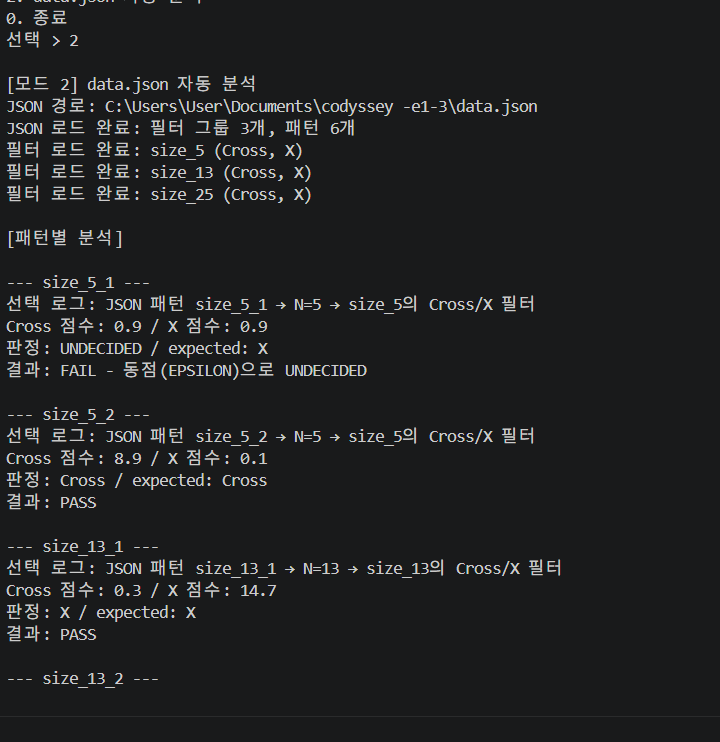
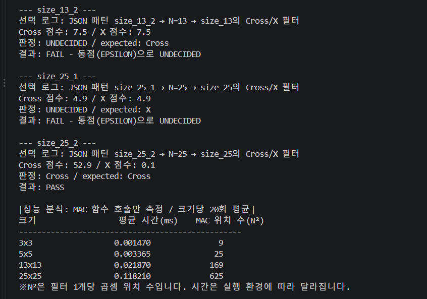
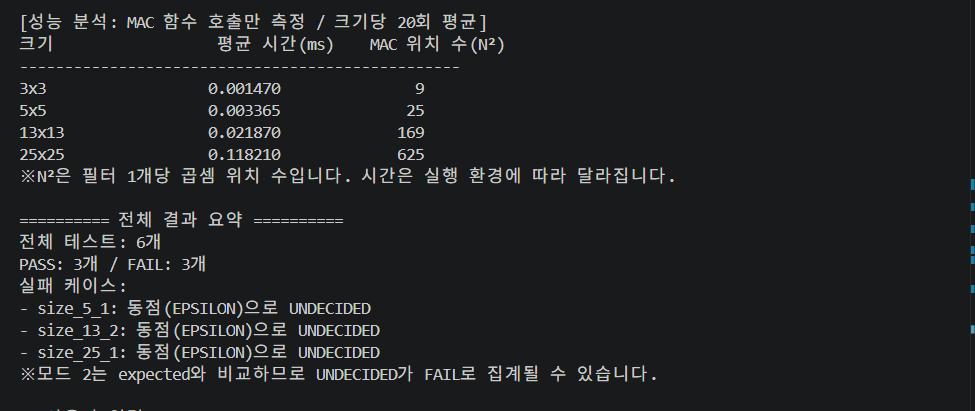

# Codyssey E1-3: Mini NPU Simulator

## 프로젝트 소개

이번 미션에서는 Python의 2차원 리스트와 반복문으로 MAC(Multiply-Accumulate) 계산을 구현합니다. 이미지의 Cross(십자가)와 X 모양을 숫자로 비교하고 어떤 필터의 점수가 더 높은지 판정합니다. AI 전용 칩 자체를 만드는 것이 아니라 계산 원리를 간단하게 실습하는 프로젝트입니다.

## 실행 환경과 파일 구조

- Python 3.8 이상, 외부 라이브러리 없이 표준 라이브러리만 사용합니다.
- `main.py`: 모드 선택, 입력 검사, MAC 계산, 판정, JSON 분석, 성능 측정
- `data.json`: 과제에서 제공받은 원본 데이터(같은 폴더에 배치, 수정하지 않습니다)
- `README.md`: 실행 방법, 구현 설명 및 결과 리포트

## 실행 방법

VS Code에서 프로젝트 폴더를 연 뒤 PowerShell 터미널에서 아래 명령을 실행합니다.

```powershell
python -m py_compile main.py
python main.py
```

메뉴 `1`은 사용자가 3×3 필터 두 개와 패턴을 직접 입력합니다. 메뉴 `2`는 `data.json`에 있는 필터와 패턴을 자동으로 분석합니다. 메뉴 `0`은 종료입니다.

## 모드 1 입력 및 예상 점수 예시

필터 A(십자가)를 아래 세 줄로 입력합니다.

```text
0 1 0
1 1 1
0 1 0
```

필터 B(X)를 아래 세 줄로 입력합니다.

```text
1 0 1
0 1 0
1 0 1
```

입력 패턴도 X 모양으로 입력합니다.

```text
1 0 1
0 1 0
1 0 1
```

이론적으로 A 점수는 1.0, B 점수는 5.0이며 판정은 B입니다. 프로그램 화면에서는 필터 2개 입력 완료, 두 점수, 평균 MAC 시간(ms), 최종 판정을 같은 결과 구역에 표시합니다. Windows PC에서 직접 실행한 결과 A=1, B=5, 판정 B를 확인했습니다. 최근 모드 1 실행에서 필터당 MAC 호출 20회 평균 처리 시간은 **0.003010 ms**, 별도 3×3 성능표의 20회 평균은 **0.003015 ms**였습니다. 두 값은 측정 대상과 측정 시점이 달라 조금 다를 수 있습니다. **제출용 스크린샷은 아직 첨부하지 않았습니다.**

## 모드 2와 오류 처리

`main.py`와 같은 폴더에 과제에서 제공한 원본 `data.json`을 배치합니다. JSON의 `filters`와 `patterns`를 읽고, `size_N_번호` 키에서 크기 N을 추출해 `filters[size_N]`의 필터를 선택합니다. `cross`와 `+`는 Cross로, `x`는 X로 표준화합니다. 각 패턴의 `input`과 필터가 N×N인지 확인하고 결과와 `expected`를 비교하여 PASS/FAIL로 표시합니다. 문제가 있는 패턴 하나는 FAIL 처리하고 다른 패턴은 계속 검사합니다.

3×3 직접 입력에서는 열 개수가 틀리거나 숫자로 바꿀 수 없거나 NaN/무한대이면 해당 행을 다시 입력받습니다. 실제로 `01`, `0a1` 입력 시 숫자 3개 형식 오류가 표시되었고, `0 A 1` 입력 시 숫자 입력 오류가 표시된 뒤 모두 `1행 >`으로 돌아왔습니다. NaN/무한대 입력은 아직 직접 시험하지 않았습니다. JSON에서는 행/열 개수, 숫자 자료형, 필요한 필터 및 라벨을 확인합니다. `data.json`이 없거나 최상위 구조 자체가 잘못되면 원인을 알리고 모드 2를 중단하며, 프로그램 메뉴는 유지합니다.

### JSON 오류 처리 추가 검증

원본 `data.json`을 수정하지 않고 별도의 `test_json_validation.py` 파일을 사용해 JSON 오류 처리를 시험했습니다.

일부러 배열의 열 개수가 맞지 않는 사례를 만들었더니 해당 사례가 FAIL로 처리되었습니다. 오류가 발생한 이후에도 다음 사례의 분석이 계속 진행되었고, 전체 6개 사례도 정상적으로 집계되었습니다.

시험 결과는 4개 항목 모두 PASS였습니다. 이번 실습을 통해 일부 데이터에 오류가 있어도 프로그램 전체가 중단되지 않도록 처리하는 것이 중요하다는 점을 배웠습니다.

## 판정 규칙

각 위치의 `패턴값 × 필터값`을 이중 반복문으로 모두 더합니다. 두 점수의 차이가 `EPSILON = 1e-9`보다 작으면 `UNDECIDED`로 판정합니다. 이 규칙은 작은 부동소수점 오차를 동점으로 간주하려는 것입니다. 모드 1은 정답 데이터가 없어 PASS/FAIL이 없습니다. 모드 2에서는 정답과 일치해야 PASS이므로, `UNDECIDED`는 정답이 Cross 또는 X라면 FAIL입니다.

## 결과 리포트

1. **첨부된 원본 `data.json`을 수정하지 않고 분석한 결과입니다.**
2. 전체 테스트 수: **6개**입니다.
3. PASS 수: **3개** (`size_5_2`, `size_13_1`, `size_25_2`)입니다.
4. FAIL 수: **3개** (`size_5_1`, `size_13_2`, `size_25_1`)이며 모두 동점 판정으로 인한 FAIL입니다.
5. `expected`는 `+`를 Cross, `x`를 X로 바꾸어 비교합니다.
6. 지원하지 않는 라벨이 나오면 라벨 문제로 FAIL 사유를 표시합니다.
7. 행 수, 열 수, 숫자 자료형이 잘못되었다면 데이터/스키마 문제로 구분합니다.
8. 필터와 입력의 크기가 다를 때도 데이터/스키마 문제로 분류합니다.
9. MAC 계산 결과와 기대 정답이 다르면 데이터의 내용이나 판정 로직을 함께 확인해야 합니다.
10. 두 점수의 차이가 `1e-9`보다 작으면 수치 비교 정책에 따라 `UNDECIDED`가 됩니다.
11. `UNDECIDED`로 인한 FAIL은 계산 실패와 달리 동점 정책으로 인한 결과일 수 있습니다.
12. 한 필터의 N×N MAC에서는 N²개의 위치를 방문하므로 시간 복잡도는 O(N²)입니다.
13. 3×3은 9개, 5×5는 25개, 13×13은 169개, 25×25는 625개 위치를 계산합니다.
14. 성능 측정은 MAC 함수를 20회 호출한 시간을 평균하며 파일 읽기와 콘솔 출력은 측정하지 않습니다.
15. 이론상 N이 2배가 되면 반복 위치 수는 4배가 되지만 실제 시간 비율은 실행 환경에 따라 달라집니다.
16. Python 반복문과 데이터 접근은 CPU에서 실행됩니다. NPU는 이러한 연산의 병렬화에 특화되어 있으나 이번 실습에서 NPU를 직접 측정하지는 않습니다.
17. 원본의 `size_5_1`은 Cross=0.9, X=0.9로 동점이며 기대 라벨은 X입니다.
18. 원본의 `size_13_2`는 Cross=7.5, X=7.5로 동점이며 기대 라벨은 Cross입니다.
19. 원본의 `size_25_1`은 Cross=4.9, X=4.9로 동점이며 기대 라벨은 X입니다.
20. 나머지 세 사례는 기대 라벨과 일치하여 PASS입니다. 원본 정답이나 필터값은 수정하지 않았습니다.
21. 아래 성능 표는 Windows PC의 모드 2에서 실제 출력된 값입니다. 실행 환경과 시점에 따라 값이 달라질 수 있습니다.

### 성능 측정 결과

| 크기 | N² 위치 수 | 평균 MAC 시간(ms) |
|---|---:|---|
| 3×3 | 9 | 0.001395 |
| 5×5 | 25 | 0.003620 |
| 13×13 | 169 | 0.013980 |
| 25×25 | 625 | 0.034205 |

위 값은 **직접 실행한 Windows PC의 모드 2 로그에서 확인한 측정값**입니다. 각 크기별 MAC 함수 호출 20회 평균이며 파일 읽기·콘솔 출력은 제외했습니다. 모드 1을 별도로 재실행했을 때 3×3 평균은 0.003015 ms로 측정되었습니다. 실행 시점과 시스템 상태가 다르면 값은 달라질 수 있습니다.

### 추가로 공부할 내용: 대형 입력과 CPU/NPU

1000×1000 입력은 1,000,000개 위치를 처리합니다. 1000은 짝수이므로 Cross의 가운데 위치를 정할 때는 예를 들어 가운데 두 행과 두 열을 선택하는 규칙이 필요합니다. 대형 행렬 전체를 메모리에 보관하는 방식과 한 행씩 처리하는 방식은 메모리 요구량이 다를 수 있습니다. 리스트 크기와 전체 프로세스 메모리(RSS)는 서로 다릅니다. 이 비교는 개념 설명이며 1000×1000 실행 결과를 실측한 것이 아닙니다. CPU의 Python 반복 비용과 NPU의 병렬 MAC, 메모리 대역폭 및 데이터 이동 병목에 대한 비교도 이론적 설명입니다.

## 스크린샷 및 배운 점

### 실행 결과 증빙

모든 화면은 Windows PC의 VS Code에서 직접 프로그램을 실행하고 캡처했습니다.

**1. 모드 1 — MAC 계산 및 최종 판정**


**2. 모드 1 — 잘못된 입력 오류 처리**



**3. 모드 2 — JSON 자동 분석 결과 (첫 번째)**



**4. 모드 2 — JSON 자동 분석 결과 (두 번째)**



**5. 모드 2 — 성능 측정 및 결과 요약**




**배운 점(초안):** 3×3 배열을 입력해 두 필터의 MAC 점수를 비교해 보니 입력이 X 모양일 때 A=1, B=5로 B가 선택되는 과정을 확인할 수 있었습니다. 숫자 개수가 맞지 않거나 문자가 들어가면 프로그램이 바로 종료되지 않고 다시 입력하도록 안내하는 것도 직접 시험했습니다. JSON 분석에서는 정답과 다른 결과가 나왔다고 해서 반드시 코드 오류는 아니며, 작은 점수 차이를 동점으로 처리하는 정책 때문에 FAIL이 나올 수도 있다는 점을 알게 되었습니다. 이 문장은 실제로 이해한 내용에 맞춰 제출 전에 자유롭게 수정하면 됩니다.

## GitHub 업로드

실제 실행과 증빙을 마친 뒤 자신의 저장소에서 다음 명령을 사용합니다.

```powershell
git status
git add main.py README.md data.json
git commit -m "Complete Codyssey E1-3 basic assignment"
git push origin main
```

`data.json`이 실제로 존재할 때만 위 `git add` 명령을 그대로 실행합니다. 기본 브랜치 이름이 `main`이 아닌 경우 실제 브랜치 이름에 맞게 변경합니다.
